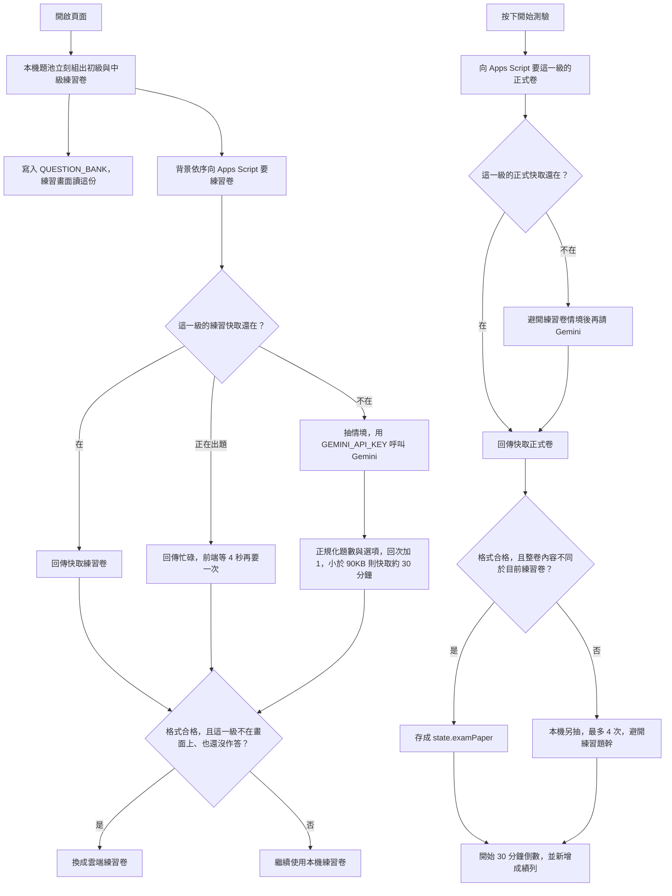

# 題目抓取流程

練習與正式測驗都是「先用本機題卷，雲端卷合格才換上」。練習在開頁時於背景準備；正式卷要等按下開始測驗才抓，而且會避開當時的練習卷。成績試算表是開考之後才寫，不參與出題。

頁面與腳本：

- 前端：`src/index.html`（`seedDynamicBanks`、`refreshPracticePapersFromGemini`、`fetchGeminiPaper`、`startNewExam`、`applyGeminiPayload`）
- 雲端：`gas/Code.gs` 的 `doGet?action=generateQuestions` → `generateQuestionPaper`
- 金鑰：Apps Script「專案設定 → 指令碼屬性」的 `GEMINI_API_KEY`，不寫進網頁

## 1. 開頁當下

`DOMContentLoaded` 先做本機組卷，再向雲端要練習卷。

1. `seedDynamicBanks()` 用頁內題池 `buildParameterizedQuestionSet` 立刻組出初級、中級各一回，寫進 `QUESTION_BANK`。兩級回次都從 `generationCount`（預設 1）來，並用 `snapshotPracticeStems` 記下這回抽到的題幹鍵。
2. 進入練習只讀 `QUESTION_BANK`，不會再發一次出題請求。重置練習只清作答，不重新要題。
3. `refreshPracticePapersFromGemini()` 接著在背景依序請求初級、再請求中級（`purpose=practice`）。

本機題池每題自帶正解索引 `ok`、解析 `why`、答對率 `rate`。組卷時 `emitMcq` 洗牌，把洗完後的位置寫進 `q.answer`，解析放進 `dynamicMetaMap[題號]`。HTML 裡寫死的那份 `QUESTION_BANK` 會被這一步蓋掉；組卷若丟出例外，畫面才留著那份寫死題目。

## 2. 向雲端要題（練習與正式共用）

兩邊都對已部署的 Apps Script 發 `GET`：

```text
GAS_WEBAPP_URL?action=generateQuestions&level=初級或中級&purpose=practice或exam&t=時間戳
```

`fetchGeminiPaper` 單次最長等 50 秒。腳本回傳忙碌時，前端等 4 秒再要一次。

`generateQuestionPaper` 的順序：

1. 級別必須是「初級」或「中級」。沒有 `GEMINI_API_KEY` 就直接失敗，前端維持本機卷。
2. 先查快取。命中且內容完整就直接回傳，保留約 30 分鐘（1800 秒）。這段時間內不同裝置可能拿到同一回。
3. 同一鍵正在出題時回傳 `{ ok: false, busy: true }`。忙碌閘門約 55 秒。
4. 沒有快取時抽出一個情境主題，呼叫 Gemini。先用 `gemini-2.5-flash`；若該模型回 400，再用不帶 thinking 的同一模型試一次；若回 404，改 `gemini-2.0-flash`。
5. 回傳 JSON 後，`normalizeQuestionPaper` 檢查題數、洗牌選項、補上題號與解析。全域回次 `GEMINI_PAPER_ROUND` 成功才加 1。
6. 整包小於 90KB 才寫入快取。

題量固定為聽力 10、閱讀 10、口說 5。寫作依級別：初級是單句 3 題加看圖段落；中級是中譯英加英文作文。

快取鍵依級別與用途分開：

| 用途 | 初級 | 中級 |
| :--- | :--- | :--- |
| 練習 | `gq3_e_practice` | `gq3_i_practice` |
| 正式 | `gq3_e_exam` | `gq3_i_exam` |

## 3. 練習卷何時換成雲端題

雲端卷要同時符合這些條件才覆寫 `QUESTION_BANK` 與 `practiceRound`：

- `usableRemoteSet` 通過：聽力 10、閱讀 10、口說 5；聽力選項數初級 3、中級 4，閱讀每題 4 個；答案索引落在選項範圍內；口說有英文口白與 `expectedKeywords`；寫作結構符合該級別。
- 這一級目前不在練習畫面上。
- 這一級還沒有作答（`practiceHasWork`）。

沒有金鑰、逾時、格式不合、這一級正在畫面上，或已經有作答時，畫面維持開頁時的本機卷。套用時會去掉題幹裡的 `<` 與 `>`，前端不再重算正解索引。

## 4. 正式卷

按下大廳的開始測驗，或練習區的「準備好了！轉往正式測驗」，`startNewExam` 才對該級別發 `purpose=exam`。倒數要等這次回應處理完才從 30:00 開始。

正式卷快取與練習卷分開。若當時還沒有正式卷快取、需要新出題，腳本會讀練習卷快取裡的情境主題，並叫 Gemini 避開那個主題。

回傳後存進 `state.examPaper`，不蓋掉練習卷。作答畫面用 `bankForExam`：有正式卷就用正式卷。雲端失敗、格式不合，或 `paperSignature` 與目前練習卷相同時，改走 `prepareFreshExamPaper`：本機題池最多重抽 4 次，抽題時擋住練習卷用過的題幹鍵。試卷定下來之後才產生測驗序號，並在成績表新增一列「進行中」。

## 5. 練習與正式的差異

取題通道相同，套上去與退回本機的規則不同。

| | 練習 | 正式測驗 |
| :--- | :--- | :--- |
| 何時要 | 開頁後背景依序要初級、中級 | 按下開始測驗時，只向該級別要一次 |
| 快取鍵 | `gq3_*_practice` | `gq3_*_exam` |
| 出新題 | 只抽一個情境 | 若練習卷還在快取，出題時避開那個情境 |
| 存到哪 | 條件符合才覆寫 `QUESTION_BANK` | 存進 `state.examPaper`，練習卷留在原處 |
| 不採用雲端卷時 | 這一級正在練習畫面上，或已經有作答，就維持本機卷 | 雲端失敗，或整卷內容與目前練習卷相同，就在本機另抽，最多 4 次，並避開練習題幹 |



## 6. 取題後答案如何寫上題目

正解在組卷時就寫在題目上。瀏覽器拿到卷之後只核對格式並清掉 `<`、`>`，不再重算哪一個選項才對。考生點的是選項位置，系統用那個位置和題上的正解索引比對。

### 聽力、閱讀

雲端卷由 Gemini 在 JSON 裡給 `answer`（從 0 起算，或寫 A–D）。`answerIndex` 轉成索引；索引超出選項數，整卷作廢。`shuffleChoices` 打亂選項，並把「這一格是正解」一起搬走，再把新位置寫回 `q.answer`，選項文字補上 `A. `、`B. `。初級短文聽解的圖片代號跟文字一起洗，圖仍對到同一格。解析 `why` 與答對率 `rate`（限制在 60–90）以題號放進 `meta`。套用時抄進 `dynamicMetaMap`。

本機卷同樣在洗牌後把新索引寫進 `q.answer`。比對只看索引是否相同，不看選項開頭的字母。

- 練習：一點選項就把位置存進該題。位置等於 `q.answer` 即答對，該格標「正解」，並秀出解析與聽力原文。
- 正式測驗：作答中只記下所選位置，畫面上不標正解。計分是答對題數 × 12。交卷檢討時才用同一組索引對出正確選項文字。

### 口說、寫作

這兩科沒有單一正解索引。

口說題帶著 `expectedKeywords`。雲端若沒給夠關鍵字，腳本會從英文口白裡抽字補上。錄音轉成文字後，`gradeSingleSpeakingItem` 計算句子裡出現多少關鍵字，再搭配字數換成流利度、文法兩個 0–5 級分，相加後 × 10 得到該題分數。

寫作題帶著 `keywords` 與 `sample`。正式測驗的單句、中譯英依關鍵字命中數給級分，段落與作文再依字數給級分，最後套用該級別的換算公式。練習區的「填入參考範例」填的就是這個 `sample`。
